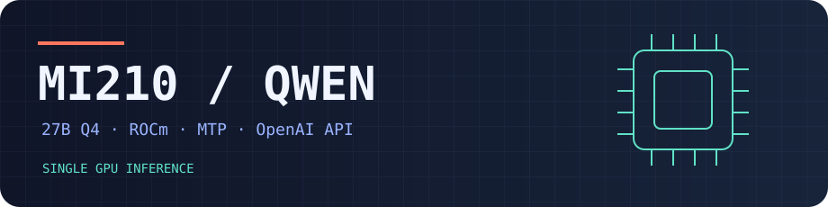
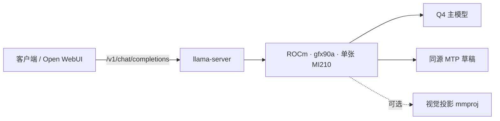

<p align="center"></p>

<p align="center">
  
  
  
  
</p>

**用一张 MI210 跑 Qwen3.8-27B Q4。** 从源码构建 llama.cpp，用 systemd 管理服务，按同一个脚本测单请求和并发。权重由使用者单独下载。

[快速启动](#快速启动) · [实测数据](#实测数据) · [常驻部署](#常驻部署)



## 实测数据

Ubuntu 24.04 / MI210 64 GB / llama.cpp HIP / Huihui Qwen3.8-27B UD-Q4_K_XL。总上下文 65,536，四槽各 16,384。固定每路生成 128 token，关闭提示缓存。同卡对比使用外置同源 MTP 草稿。

| 测项 | 无 MTP | MTP，最多 3 token |
|:--|--:|--:|
| 单请求生成 | 25.4 tok/s | **45.8 tok/s** |
| 单请求总耗时 | 6.31 s | **3.19 s** |
| 四路并发，每路生成 | 17.8–18.3 tok/s | **24.2–26.7 tok/s** |
| 四路并发，最慢请求 | 12.08 s | **8.79 s** |

另一张 MI210 的短提示扫参中，长度 2 最高达 57.8 tok/s。五类单请求的中位数却从长度 3 的 49.7 降至 32.8 tok/s，因此默认使用 3。五条贪心压测输出中有三条未逐字匹配，基础文本与单图冒烟通过。速度取决于提示、上下文、并发和草稿接受率。

## 快速启动

需要 AMD Linux 驱动与 ROCm 工具链、CMake、Git、curl、Python 3。运行用户需要访问 `/dev/kfd` 和 `/dev/dri`，通常通过 `render` 和 `video` 组。先确认 `rocminfo` 能看到 `gfx90a`。

```bash
git clone https://github.com/ggml-org/llama.cpp.git
git -C llama.cpp checkout 7592b61d3b53ca5b39a25a03508fa1246b78c579
cmake -S llama.cpp -B llama.cpp/build \
  -DCMAKE_BUILD_TYPE=Release -DGGML_HIP=ON -DAMDGPU_TARGETS=gfx90a \
  -DCMAKE_C_COMPILER=/opt/rocm/bin/hipcc -DCMAKE_CXX_COMPILER=/opt/rocm/bin/hipcc \
  -DGGML_HIP_GRAPHS=ON -DGGML_HIP_MMQ_MFMA=ON -DGGML_HIP_NO_VMM=ON
cmake --build llama.cpp/build --target llama-server -j "$(nproc)"
```

从[模型发布页](https://huggingface.co/huihui-ai/Huihui-Qwen3.8-27B-abliterated-GGUF)下载 `Huihui-Qwen3.8-27B-abliterated-UD-Q4_K_XL.gguf`。以下命令从本仓库根目录执行。默认使用 GGUF 内置的 MTP 头。外置同源草稿可通过 `DRAFT_MODEL` 指定；没有 MTP 头时设置 `MTP=0`。传入配套 `MMPROJ` 可启用图像输入。

```bash
LLAMA_BIN="$PWD/llama.cpp/build/bin/llama-server" \
MODEL="/opt/models/Huihui-Qwen3.8-27B-abliterated-UD-Q4_K_XL.gguf" \
GPU=0 bash scripts/serve.sh
```

在另一个终端验证 API，再运行复测。单用户建议在空闲卡上连续跑两遍，记录输入长度、输出 token 数和总耗时。

```bash
curl -fsS http://127.0.0.1:8000/health
curl -fsS http://127.0.0.1:8000/v1/chat/completions \
  -H 'Content-Type: application/json' \
  -d '{"model":"qwen3.8-27b","messages":[{"role":"user","content":"Say hello."}],"max_tokens":32}'
python3 scripts/benchmark.py 8000
```

## 常驻部署

将仓库放到 `/opt/mi210-qwen-deploy`，以 root 安装下列文件。已存在的 `qwen` 用户可直接复用。环境文件里用绝对路径，并确认该用户可读模型和运行二进制。

```bash
id qwen >/dev/null 2>&1 || sudo useradd --system --no-create-home qwen
sudo usermod -aG render,video qwen
sudo chmod +x scripts/serve.sh
sudo install -m 0644 systemd/qwen-mi210.service /etc/systemd/system/
sudo install -m 0600 systemd/qwen-mi210.env.example /etc/qwen-mi210.env
sudoedit /etc/qwen-mi210.env
sudo systemctl daemon-reload
sudo systemctl enable --now qwen-mi210
sudo journalctl -u qwen-mi210 -n 60 --no-pager
```

默认只监听回环地址。局域网客户端可通过带认证的反向代理接入，也可使用 SSH 端口转发。Open WebUI 的 OpenAI 兼容连接指向客户端可达的 `/v1` 地址。调参前备份环境文件，恢复后重启该服务即可回滚。

部署脚本与文档采用 Apache-2.0。llama.cpp、ROCm、模型权重按各自许可证提供。进一步的 AMD W4A16 实验可参考 [Marlin / DFlash 单卡适配](https://github.com/hyl64/mi210-qwen3.8-inference)，其模型与本仓库基准不同。
